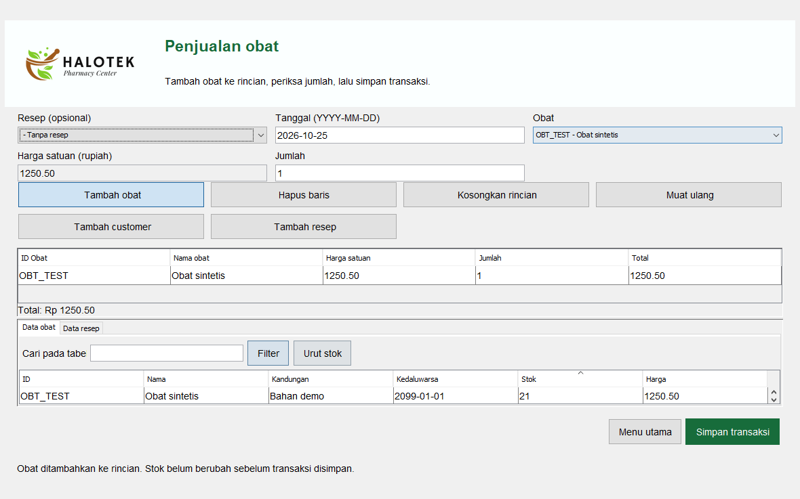

# HaloTek Drug Store

Aplikasi desktop apotek menggunakan Java Swing dan SQL Server. Admin mengelola data master dan pembelian, Kasir mencatat penjualan, dan Kepala melihat laporan bulanan. Nama repo `drug-store-app`; nama aplikasi di layar tetap **HaloTek**.

Proyek ini melanjutkan aplikasi Swing lama dengan 20 nama kelas asli. Form IntelliJ dipindahkan ke Java Swing biasa agar bisa dibangun melalui Maven tanpa plugin GUI Designer. Logo dan gambar HaloTek asli tetap dipakai. Kredit pada form asal: **Ariza dan Youmal**.



Gambar menampilkan aplikasi Swing yang dijalankan oleh pengujian desktop, memakai data sintetis.

## Yang tersedia

| Peran | Menu |
| --- | --- |
| Admin | User, Customer, Supplier, Kategori, Obat, Resep, Pembelian |
| Kasir | Customer, Obat, Resep, Penjualan |
| Kepala | Laporan pembelian dan penjualan per bulan; preview cetak dan ekspor PDF melalui JasperReports |

Data master bisa ditambah, dicari berdasarkan ID/nama, diubah, dan dihapus. Customer dan supplier dinonaktifkan saat dihapus agar riwayatnya tetap tersedia. Data yang masih dirujuk transaksi dilindungi oleh foreign key.

Pembelian menambah stok; penjualan menguranginya. Header, detail dan perubahan stok disimpan dalam satu transaksi database. Penjualan mendukung resep opsional, menolak stok kurang dan obat kedaluwarsa. Form transaksi menyediakan pencarian tabel, urut stok, rincian belanja, serta penambahan customer/resep. Harga penjualan diperiksa kembali saat menyimpan.

Password memakai PBKDF2-HMAC-SHA256 dengan salt acak per akun. Daftar user tidak menampilkan password atau hash. Pemeriksaan peran juga dilakukan pada service Java. Aplikasi desktop memakai satu koneksi database yang dikonfigurasi operator; ini belum merupakan pemisahan izin per pengguna di tingkat SQL Server.

## Persiapan

- JDK 17 dan Maven 3.9.
- Windows, Linux, atau macOS dengan sesi desktop untuk membuka Swing.
- SQL Server yang bisa diakses. Pilihan Docker di bawah menyediakan database lokal; jendela Swing tetap berjalan pada komputer host.
- Docker Desktop/Engine hanya diperlukan bila memilih database Docker. SQL Server membutuhkan ruang disk dan RAM yang cukup; jalankan setelah layanan berat lain selesai.

Driver SQL Server dan JasperReports diunduh Maven dari dependensi pada [pom.xml](pom.xml). Tidak perlu menyalin JAR dari folder `lib` lama. [Dokumentasi Microsoft](https://learn.microsoft.com/en-us/sql/connect/jdbc/system-requirements-for-the-jdbc-driver) menjelaskan dukungan Java pada driver JDBC.

## 1. Siapkan database demo dengan Docker

Clone repo, lalu masuk ke foldernya melalui PowerShell:

```powershell
git clone https://github.com/zalamanga/drug-store-app.git
cd drug-store-app
```

Salin contoh konfigurasi dan buka dengan editor:

```powershell
Copy-Item .env.example .env
notepad .env
```

Isi `MSSQL_SA_PASSWORD` dengan password lokal baru yang berisi minimal 12 karakter, termasuk huruf besar, huruf kecil, angka dan simbol. Simpan lalu tutup editor. `.env` diabaikan Git. Setelah itu:

```powershell
docker compose up -d --wait
docker compose exec -T db /opt/mssql-tools18/bin/sqlcmd -S localhost -U sa -C -b -i /setup/create-demo.sql
```

Compose menggunakan nama proyek `halotek-demo`, port host **14343**, dan volume tersendiri. Port dibatasi ke `127.0.0.1`. Database yang dibuat adalah `halotek_demo`. Perintah `sqlcmd` mengambil password dari environment `SQLCMDPASSWORD` yang diatur Compose, sehingga tidak meminta password lagi. Tidak ada MDF/LDF, akun, customer, resep, atau transaksi dari database lama yang disertakan.

Untuk SQL Server yang sudah tersedia, buat database kosong khusus demo dan sesuaikan `DB_URL`, `DB_USER`, serta `DB_PASSWORD` pada langkah berikutnya. Jangan arahkan perintah setup ke database operasional.

## 2. Buat schema dan akun Admin pertama

Masih pada PowerShell yang sama:

```powershell
$env:DB_URL = 'jdbc:sqlserver://localhost:14343;databaseName=halotek_demo;encrypt=true;trustServerCertificate=true'
$env:DB_USER = 'sa'
$dbSecret = Read-Host 'Masukkan password SQL Server yang sama dengan MSSQL_SA_PASSWORD di .env' -AsSecureString
$env:DB_PASSWORD = [System.Net.NetworkCredential]::new('', $dbSecret).Password
$env:HALOTEK_ADMIN_USERNAME = 'admin-demo'
$adminSecret = Read-Host 'Password Admin aplikasi (12 sampai 128 karakter)' -AsSecureString
$env:HALOTEK_ADMIN_PASSWORD = [System.Net.NetworkCredential]::new('', $adminSecret).Password

mvn package
java -cp 'target/drug-store-app-1.0.0.jar;target/lib/*' app.core.DatabaseSetup --empty-demo-database
```

Setup hanya membuat schema baru dan satu akun Admin. Schema yang sudah ada tidak dihapus atau ditimpa. Jika tabel sudah ada, setup berhenti; cukup jalankan aplikasinya dengan akun yang telah dibuat. Definisi tabel sintetis ada pada [schema.sql](src/main/resources/db/schema.sql), disusun dari tabel/kolom yang dipakai kode asal. Ini bukan migrasi atau pemulihan database lama.

`trustServerCertificate=true` pada contoh dipakai untuk sertifikat lokal Docker. Sesuaikan koneksi dan sertifikat jika menggunakan server lain. Untuk demo lokal, akun `sa` memudahkan setup; gunakan akun database dengan izin yang dibatasi bila mengembangkan penerapan lebih lanjut.

## 3. Jalankan aplikasi

```powershell
java -jar target/drug-store-app-1.0.0.jar
```

Jalankan dari shell yang memiliki `DB_URL`, `DB_USER`, dan `DB_PASSWORD`. Java membaca environment proses, **bukan file `.env` secara otomatis**. Alternatifnya, gunakan properti `halotek.db.url`, `halotek.db.user`, dan `halotek.db.password`; jangan menaruh kredensial di dalam JDBC URL atau commit file konfigurasi lokal.

Di Linux/macOS, pemisah classpath pada perintah setup adalah `:`:

```sh
java -cp 'target/drug-store-app-1.0.0.jar:target/lib/*' app.core.DatabaseSetup --empty-demo-database
java -jar target/drug-store-app-1.0.0.jar
```

Folder `target/lib` harus tetap berada di sebelah JAR utama. JAR utama saja tidak memuat semua dependensi.

## Alur mencoba aplikasi

1. Masuk sebagai Admin yang dibuat saat setup.
2. Tambahkan Kategori, Supplier, lalu Obat. Isi tanggal sebagai `YYYY-MM-DD`, stok sebagai bilangan bulat, dan harga tanpa `Rp` atau pemisah ribuan; gunakan titik untuk pecahan.
3. Tambahkan akun Kasir dan Kepala melalui menu User. Setiap password baru minimal 12 karakter. Saat mengubah user, password kosong berarti mempertahankan password lama.
4. Catat Pembelian untuk menambah stok. Tambahkan obat ke rincian sebelum menekan **Simpan transaksi**.
5. Keluar akun, masuk sebagai Kasir, lalu lakukan Penjualan. Untuk penjualan dengan resep, tambahkan customer dan resep terlebih dahulu. Setelah menutup form tambahan, tekan **Muat ulang** pada transaksi.
6. Masuk sebagai Kepala, pilih bulan/tahun, lalu tampilkan laporan. **Preview cetak / PDF** aktif bila hasil laporan berisi data.

Klik baris tabel untuk mengubah data master. **Form baru** membatalkan pilihan baris dan menyiapkan ID baru. ID dihasilkan otomatis; tidak perlu mengetik nomor urut. **Esc** kembali ke menu utama. Login memakai tombol default sehingga **Enter** dapat mengirim form.

## Pengujian

```powershell
mvn test
```

Tes standar memakai database H2 sementara dengan data sintetis. Tes memeriksa hash password, validasi, hak akses, CRUD, query pencarian, rollback transaksi, stok, resep opsional, laporan bulanan, dan ekspor PDF. Tes ini tidak memakai `DB_URL` atau database lama.

Untuk interaksi Swing, jalankan di sesi desktop:

```powershell
mvn -Pdesktop-qa -Dtest=DesktopTest test
```

Harness menjalankan aksi Swing pada Event Dispatch Thread, memakai database sintetis, dan menyimpan gambar jendela aplikasinya ke `target/desktop-qa`. Profil ini dilewati pada lingkungan headless. Pengujian H2 bukan pengganti pengujian kompatibilitas SQL Server.

Tes SQL Server tersedia setelah layanan Docker lokal sehat dan environment pada langkah 2 sudah diisi:

```powershell
$env:HALOTEK_SQLSERVER_QA = '1'
mvn -Psqlserver-qa -Dtest=SqlServerIntegrationTest test
Remove-Item Env:HALOTEK_SQLSERVER_QA
```

Tes ini hanya menerima koneksi `localhost:14343` dengan nama dasar `halotek_demo`. Ia membuat database sintetis sementara berawalan `halotek_qa_20261025_`, menguji schema/login/CRUD/transaksi/rollback/laporan, lalu menghapus database sementara yang dibuatnya sendiri. Akun tes memerlukan izin membuat database. Jangan ubah pengaman koneksi untuk menjalankannya pada server operasional.

## Struktur kode

```text
src/main/java/
  Admin, Kasir, Kepala/    dashboard dengan nama kelas asal
  HaloTek/                LoginForm dan entry point
  Master/                 11 kelas form master asal
  Transaksi, Laporan/     dua transaksi dan dua laporan asal
  Config/                 konfigurasi koneksi
  app/core/               autentikasi, validasi, JDBC, transaksi, setup
  app/ui/                 komponen Swing dan laporan bersama
src/main/resources/
  Bahan/                  gambar HaloTek asli
  db/schema.sql           schema kosong untuk demo
src/test/java/            tes sintetis dan harness desktop
database/create-demo.sql  membuat database Docker jika belum ada
```

[Alur kode dan diagram](docs/CODE_FLOW.md) menjelaskan entry point Swing, pemeriksaan peran, data master, transaksi stok, dan laporan.

## Batas proyek

Aplikasi ini merupakan proyek pembelajaran apotek, dengan domain dan tampilan desktop dari sumber asal. Belum ada pembayaran daring, pajak, retur, audit perubahan, integrasi alat kasir, migrasi data lama, atau panduan operasional klinis. Dosis dan kandungan merupakan isian pengguna; aplikasi tidak menentukan rekomendasi pengobatan. Form pencarian master membatasi hasil ke 500 baris.

Laporan dibuat ulang melalui JasperReports dari query dan data bulan yang dipilih. Berkas `.jasper` biner lama tidak dipakai. Customer/supplier nonaktif tetap terlihat dalam daftar master, tetapi tidak ditawarkan untuk transaksi baru.

Tidak ada lisensi sumber atau aset yang ditemukan pada root proyek asal. Kredit asli tetap dicantumkan; repo ini tidak menetapkan lisensi baru atau mengklaim kepemilikan gambar pihak lain.

Untuk menghentikan database demo tanpa menghapus isinya:

```powershell
docker compose stop db
```
