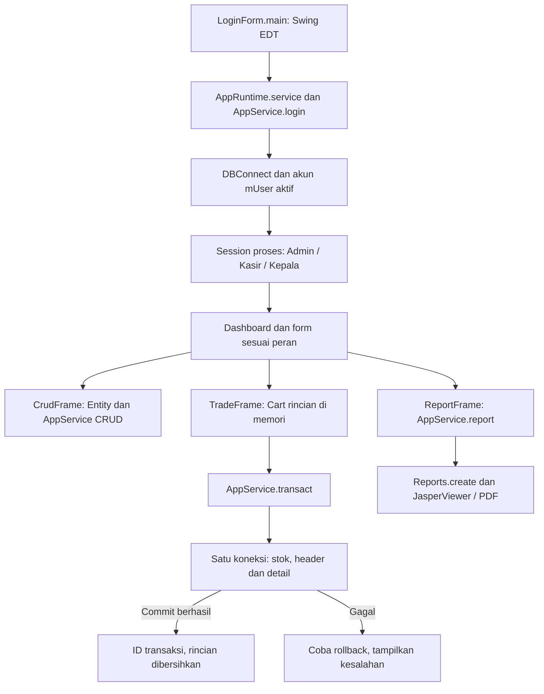

# Alur kode HaloTek Drug Store

HaloTek adalah aplikasi desktop Swing, bukan website. Admin mengelola master/pembelian, Kasir mencatat penjualan, dan Kepala membaca laporan. Rincian transaksi yang belum disimpan berada dalam memori form; data master, transaksi, dan stok tersimpan di SQL Server.

## Entry point, sesi, dan tanggung jawab form

[`LoginForm.main()`](../src/main/java/HaloTek/LoginForm.java) memulai UI pada Event Dispatch Thread. [`AppRuntime`](../src/main/java/app/core/AppRuntime.java) menyediakan satu `AppService` dengan sumber koneksi `DBConnect::open`. Login mengambil akun aktif menggunakan prepared statement, memverifikasi hash, dan menyimpan ID/nama/peran dalam [`Session`](../src/main/java/app/core/Session.java) proses. Array karakter password dibersihkan setelah pemeriksaan.

[`Dashboard`](../src/main/java/app/ui/Dashboard.java) menampilkan menu menurut peran. Kelas bernama asli seperti `TransaksiPenjualan` menjadi pembungkus form bersama di `app/ui`. Pemeriksaan akses juga dilakukan oleh service/`Entity`, bukan sekadar menyembunyikan tombol. Peran diambil saat login dan berada dalam sesi proses, bukan dibaca ulang dari database pada setiap klik. Logout mengosongkan sesi tersebut.

[`BaseFrame.task()`](../src/main/java/app/ui/BaseFrame.java) menjalankan I/O melalui SwingWorker dan memperbarui UI sesudahnya. Flag `working` mencegah dua tugas bersamaan pada form yang sama; ini bukan deduplikasi transaksi persisten setelah aplikasi/koneksi terputus.

## Data master

`CrudFrame` memakai metadata [`Entity`](../src/main/java/app/core/Entity.java) untuk field, validasi, query, dan hak akses. [`AppService.list()`](../src/main/java/app/core/AppService.java) membatasi hasil hingga 500 baris. `save()` memakai statement insert/update terparameter; password user tidak ditampilkan sebagai kolom daftar. Customer/supplier dinonaktifkan ketika dihapus, sedangkan entitas lain menggunakan delete dengan batasan foreign key database.

Operasi master adalah statement tersendiri. Perlindungan transaksi stok berikut tidak berarti semua form master memiliki versi record atau penguncian edit lintas pengguna.

## Pembelian dan penjualan

[`TradeFrame`](../src/main/java/app/ui/TradeFrame.java) memuat obat serta supplier/resep, lalu menambahkan pilihan ke [`Cart`](../src/main/java/app/core/Cart.java). Cart menggabungkan obat yang sama dan menghitung nilai uang dengan BigDecimal. Menambah rincian belum mengubah stok database. Saat simpan, form membuat salinan rincian dan memanggil `AppService.transact()`.

Service memeriksa peran, tanggal, rincian, serta supplier aktif untuk pembelian. Pada satu koneksi dengan autocommit dimatikan, service membaca obat, memeriksa kedaluwarsa/harga penjualan, lalu menjalankan perubahan stok bersyarat. Pembelian menambah stok sampai batas; penjualan hanya mengurangi bila stok mencukupi. Baris obat diproses menurut ID untuk urutan pembaruan yang konsisten.

Header transaksi dan seluruh detail ditulis pada koneksi yang sama dengan perubahan stok. Commit dilakukan sebelum ID transaksi dikembalikan. Jika ada kesalahan, rollback dicoba. Form baru mengosongkan rincian setelah service mengembalikan hasil berhasil. Penjualan dapat memakai resep opsional; aplikasi tidak menilai dosis atau rekomendasi medis.

Setiap pemanggilan simpan membuat ID transaksi baru. Tidak ada kunci idempotensi untuk pengiriman ulang. Jika koneksi putus saat commit, periksa stok/riwayat sebelum mencoba lagi; pesan kesalahan tidak membuktikan bahwa server pasti belum menyimpan.

## Laporan dan penyimpanan

[`ReportFrame`](../src/main/java/app/ui/ReportFrame.java) meminta bulan/tahun ke `AppService.report()`, khusus peran Kepala. Query memakai rentang awal bulan sampai awal bulan berikutnya. Tabel dan preview menggunakan snapshot hasil yang sama. [`Reports.create()`](../src/main/java/app/ui/Reports.java) menyusun laporan JasperReports; JasperViewer menyediakan cetak/ekspor PDF. Tidak ada penggunaan laporan `.jasper` biner lama.

[`DatabaseSetup`](../src/main/java/app/core/DatabaseSetup.java) menyiapkan schema demo secara eksplisit; menjalankan UI tidak mengimpor database operasional lama. Aplikasi memakai kredensial database bersama dari operator. Sesi/peran Java bukan pemisahan login SQL Server per pengguna, dan rincian Cart yang belum tersimpan tidak bertahan setelah proses ditutup.
